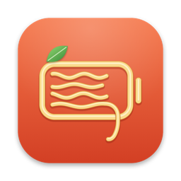

<p align="center"></p>

<h1 align="center">Scotta</h1>

<p align="center">A small, fast battery charge limiter for Apple Silicon Macs.</p>

https://github.com/user-attachments/assets/99084b37-e0fc-460f-aed4-53e569c83284

*Al dente* pasta is cooked just right.
*Scotta* is overcooked.
Scotta keeps your battery from being cooked: it stops charging at the level you choose.

Limits of 80, 85, 90, 95 and 100% use Apple's own charge limit.
macOS enforces them during sleep, with the lid closed, and when Scotta is not running.
Any other limit is held by Scotta while the Mac is awake, with the next Apple step as a ceiling.

> [!WARNING]
> Scotta uses private Apple APIs (PowerUI) and writes SMC keys as root.
> It is tested on one machine: an M4 Pro MacBook Pro on macOS 27.0.1.
> A macOS update can break it.
> Use it at your own risk.

## Features

- Charge limit (10-100%), pause, top up, discharge while plugged in, calibration (100 → 10 → 100 → hold 1 h → limit), off.
- Sailing: the battery drifts N% below the limit before charging resumes.
- Heat protection: stops charging above a temperature, with 2 °C hysteresis.
- MagSafe LED: system, off, or show state (orange charging, green holding, blinking discharging).
- Prevent sleep while charging up to the limit.
- Power mode (auto, low, high), set separately for battery and adapter.
- Stats: health, cycles, temperature, voltage, current, and system power with a 10-minute graph.
- Automation: the `scotta` CLI and `scotta://` URLs, usable from Shortcuts.

Scotta has no third-party dependencies, no network access, no analytics and no updater.
The daemon wakes only on power-source events and a 60-second timer.

## Requirements

- An Apple Silicon Mac on macOS 26 or later (tested on macOS 27).
- Xcode or the Xcode Command Line Tools (`xcode-select --install`).
- An "Apple Development" signing identity in your keychain.
  A free Apple ID added in Xcode → Settings → Accounts creates one.

## Install

```sh
git clone https://github.com/bettersandeep/scotta.git
cd scotta
make install
```

`make install` builds and signs everything as you, then asks for `sudo` to install:

| Path | What |
|---|---|
| `/Applications/Scotta.app` | Menu-bar app |
| `/Library/PrivilegedHelperTools/com.scotta.daemon` | Root daemon |
| `/Library/LaunchDaemons/com.scotta.daemon.plist` | launchd job |
| `/usr/local/bin/scotta` | CLI (link into the app) |

Quit other charge limiters, such as AlDente, before you install.
Two tools that write the same keys fight each other.

## Usage

Click the battery icon in the menu bar.
Turn on "Launch at login" to keep the icon after a restart.
The daemon keeps working when the app is closed.

```sh
scotta status                 # battery and controller state as JSON
scotta limit 80               # 10-100
scotta pause | topup | discharge | calibrate | normal | off
scotta sailing 5              # drift 5% below the limit before charging again
scotta heat on 35             # pause charging above 35 °C
scotta led indicate           # system | off | indicate
scotta sleep on               # stay awake while charging up to the limit
scotta powermode auto low     # on battery, on adapter: auto | low | high
scotta reset                  # hand control back to macOS
```

The same commands work as URLs, for example `open scotta://limit/85`.
In Shortcuts, use "Run Shell Script" or "Open URL".

## Uninstall

```sh
make uninstall
```

This hands control back to macOS first, then removes every installed file.

## How it works

| Part | Role |
|---|---|
| `scottad` | Root LaunchDaemon. Owns the settings and every system write. Applies changes only when its decision changes. |
| `Scotta.app` | SwiftUI menu-bar app. A thin XPC client, refreshed by a Darwin notification after each daemon change. |
| `scotta` | CLI over the same XPC interface. |
| `ScottaKit` | Shared model and the pure `decide()` policy, covered by unit tests. |

| Mechanism | Use |
|---|---|
| PowerUI `setMCLLimit` | Apple's manual charge limit (80/85/90/95/100), enforced by macOS |
| SMC `CHIE` = 8 | Run from battery while plugged in: discharge, sailing, heat pause, holds below 80% |
| SMC `ACLC` | MagSafe LED: 0 system, 1 off, 2 green, 4 orange, 6 orange blinking |
| SMC `TB0T` | Battery temperature |

`CHIE` is released before every system sleep, so a sleeping Mac never drains.
On macOS 27 the firmware limiter keys (`bfF0`, `bfD0`, `bfE0`) refuse access even to root, which is why limits use PowerUI.

The daemon accepts XPC clients only when they are signed by the same team as the daemon.
An unsigned daemon refuses every client.

## Development

```sh
make test        # unit tests for the charging policy and command parser
make app         # build and sign build/Scotta.app and build/com.scotta.daemon
make icon        # regenerate the icon from Support/make-icon.swift
```

Logs: `/Library/Logs/Scotta/scottad.log`.

## License

[MIT](LICENSE).
Scotta is not affiliated with Apple or with AlDente.
